# FixMyRips

Checks the CDs you've ripped to an Eversolo streamer, fixes the tags it can fix safely, and tells you which discs need ripping again. Then, standing at your CD shelf, you can snap a CD's barcode with your phone and it tells you whether that disc is already in your library.

Built for the Eversolo DMP-A6, whose CD Ripper leaves gaps in the tags: track numbers that start at 0, no track total, no disc number on multi-disc sets. It runs on the device itself, so there is no PC, no network share and no tagging software involved.

> **Made by Michael Albers.** I make honest videos about budget audio equipment, including a lot of Eversolo DMP-A6 how-tos. If this app helped you, come find more on my YouTube channel: **[youtube.com/@malbers](https://www.youtube.com/@malbers)**

## Scan a CD with your phone: is it ripped?

If you have a few hundred CDs, the hardest question is often the simplest one: did I already rip this one? **Rip Inventory** answers it from the shelf.

1. On the Eversolo, open FixMyRips and tap **Rip Inventory**. It shows a web address for your home network.
2. Open that address in your phone's browser (Safari or Chrome). No app to install on the phone.
3. Tap **Snap a CD barcode** and take a photo of the barcode on the back of the case. Or type an artist or album.
4. It answers in one line: **Ripped**, **Ripped, but needs a re-rip** (and which tracks), **Ripped, but a different edition** (this CD has 17 tracks, your rip has 14), or **Not ripped yet**.

| On the Eversolo | Snap a barcode | Not ripped yet | Ripped, and it matches |
|---|---|---|---|
| 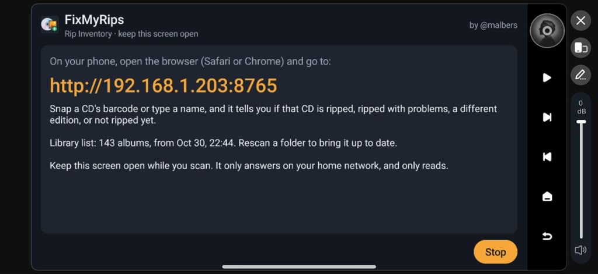 | 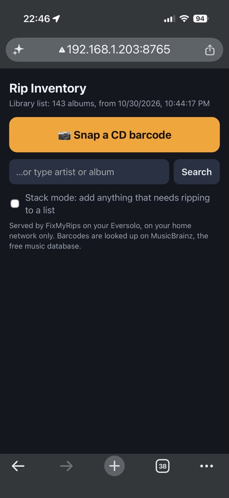 | 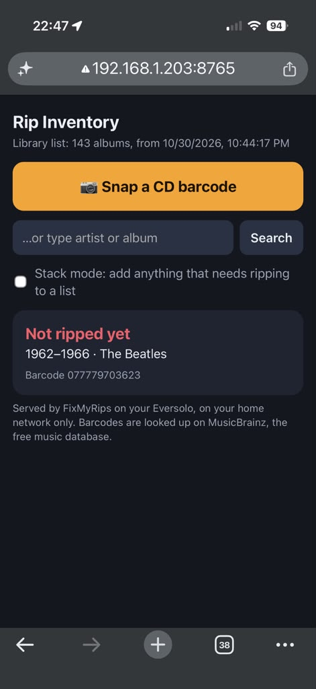 | 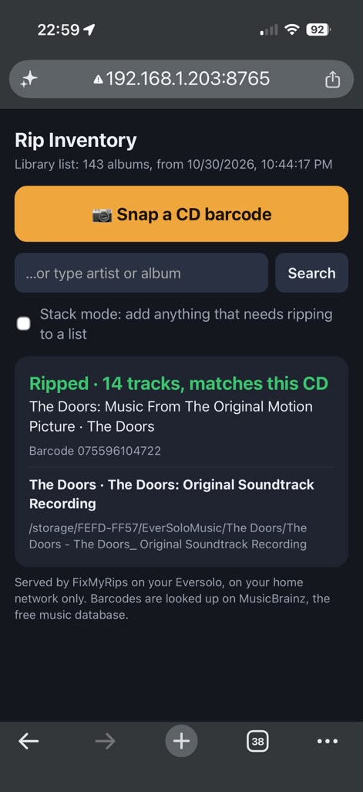 |

Turn on **Stack mode** and anything that still needs ripping goes on a list as you work through the shelf, so you finish with a pile and a to-do list.

It judges editions by track count, not by catalogue number. Several pressings of the same album share one disc, so a different number on the case doesn't mean a different CD. A different track list does.

**Where its answers come from.** Rip Inventory answers from the library list FixMyRips saves each time a folder scan finishes. Scan your music folder once before you use it. If your music lives in more than one folder (say `Music` and `EverSoloMusic`), scan each one: every scan adds that folder's albums to the same list and leaves the others in place. Rescan a folder after you rip more CDs into it.

The phone page only works on your home network, only while that screen is open on the Eversolo, and it only reads. The barcode is looked up on MusicBrainz, the free music database.

## Check and fix your rips

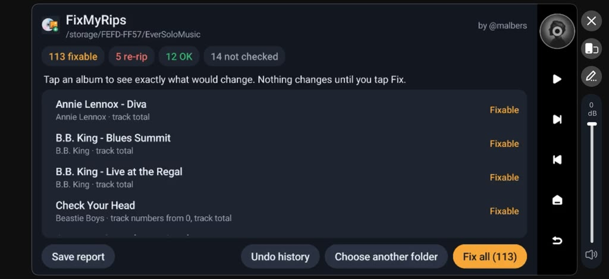

1. **Pick a folder** on the internal storage or an attached drive, e.g. `EverSoloMusic`, and tap **Scan this folder**. Every folder with audio files counts as an album.
2. **Watch it check.** Each album is compared with its release on MusicBrainz. Nothing is changed while it checks.
3. **Read the results.** Every album lands in one of four groups: **Fixable** (tags it can correct), **Re-rip** (missing, empty or cut-short tracks that only ripping again will fix), **OK**, and **Not checked** (it couldn't match the album with confidence, so it leaves it alone).
4. **Tap an album** to see exactly what would change, file by file, with a plain-words explanation of why. Nothing changes until you tap **Fix this album**, or **Fix all** for the whole list.
5. **Update your library** on the Eversolo afterwards so it reads the new tags. It may start on its own.

| Choose a folder | Checking | What would change |
|---|---|---|
| 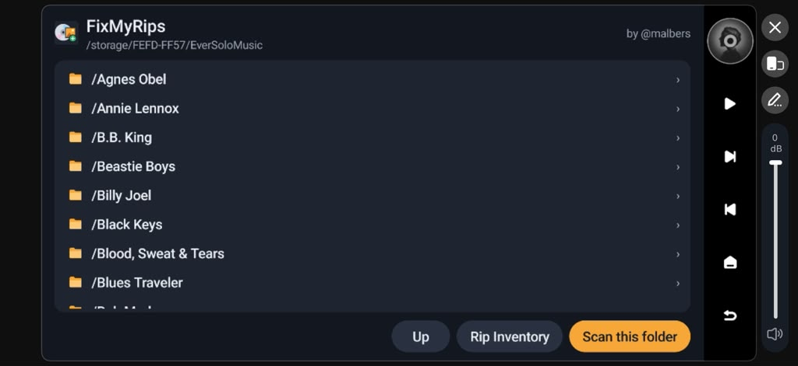 | 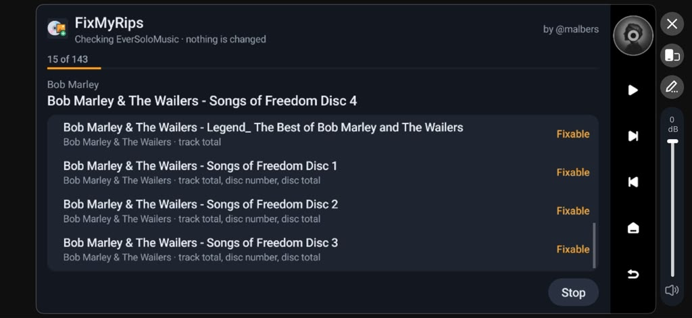 | 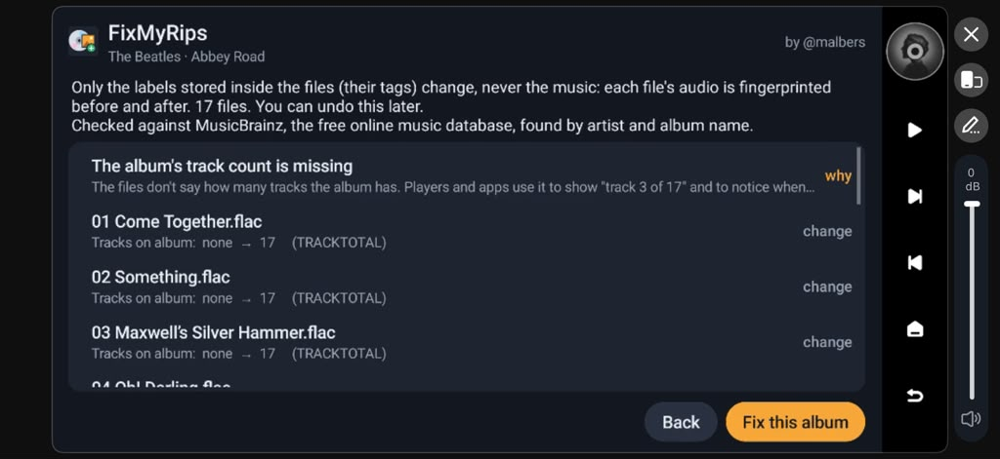 |

| Confirm | Fixed | Found a bad rip |
|---|---|---|
| 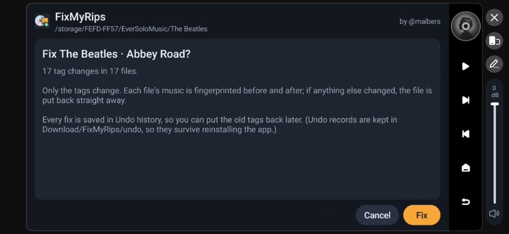 | 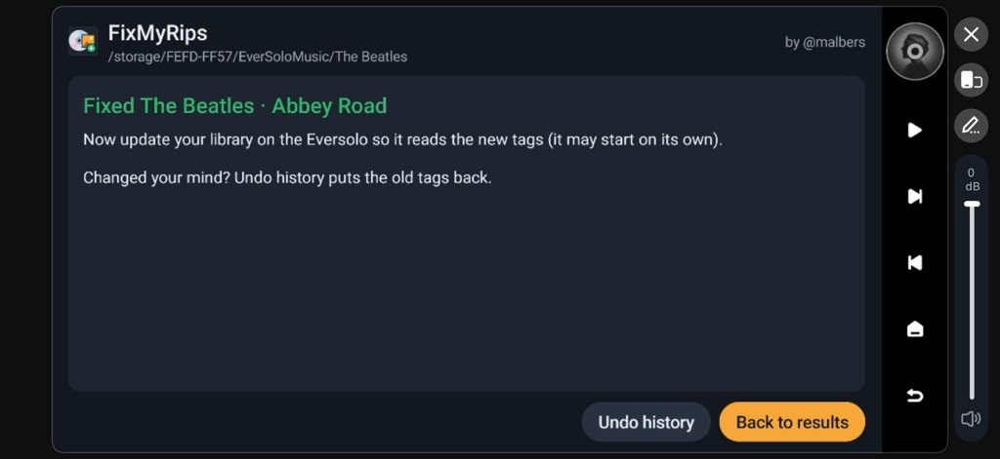 | 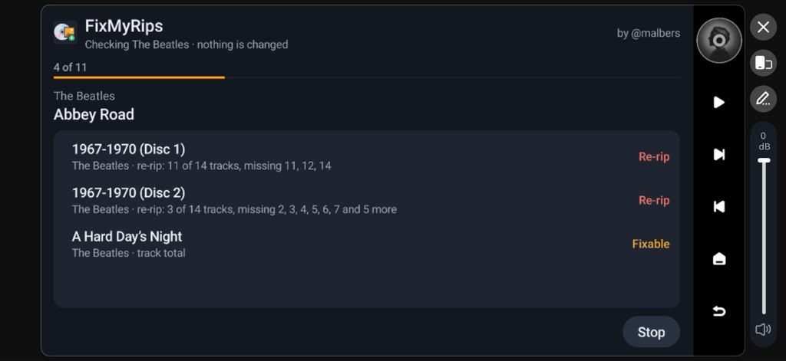 |

**Save report** keeps the full list, including what needs re-ripping, as a text file in the Eversolo's Download folder.

**What it fixes**
- **Track numbers that start at 0.** The Eversolo CD Ripper numbers the first track 0. Fixed only when every file is exactly one below the number in its file name.
- **A missing track total**, so players can show "track 3 of 17". Added only when the rip check found the album complete.
- **A missing disc number and disc total** on multi-disc sets, taken from "Disc 1", "Disc 2" folder names, and only when the sibling discs run 1 to N.

Every rule skips when it can't be sure, and says why. **A wrong tag is worse than a missing one.** Works on FLAC and MP3.

**It keeps itself up to date.** Once a day it checks for a new version. When one is out, an **Update available** button appears; one tap downloads it to the Download folder, and you install it from the Files app. No computer needed.

## What it never does

- It never changes the music. Only the tags (the labels stored inside each file) change. Each file's audio is fingerprinted before and after a fix; if anything other than the tags changed, the file is put back straight away.
- It never moves, renames or deletes a file or folder.
- It never changes anything until you tap **Fix**, and it shows you every change first.
- Every fix can be undone. **Undo history** puts the old tags back, album by album. The undo records are kept in `Download/FixMyRips/undo`, so they survive reinstalling the app.
- The only other files it writes go to `Download/FixMyRips` and the Download folder: the library list, a saved report, or a downloaded update.
- No Google Play, no Google services, no accounts, no analytics.

The app contacts only `musicbrainz.org`, pacing its requests to stay well inside MusicBrainz's limits, plus GitHub (`api.github.com`) at most once a day to see whether a newer version is out. Nothing about you or your music is sent beyond the album or barcode being looked up.

## Download

Get the latest `FixMyRips-<version>.apk` from the [releases page](https://github.com/malbers/fixmyrips/releases/latest).

Download it to your laptop or desktop, not to the Eversolo. The next section shows how to get it from your computer onto the Eversolo.

## Install

**What you're doing:** an `.apk` file is an Android app. The Eversolo runs Android underneath, so it can install apps that aren't in its app store, a process usually called "sideloading". There are two ways to get the file onto the Eversolo. Both take a couple of minutes, and you only do this once.

**Before you start:** your computer and the Eversolo must be on the same home network (the same Wi-Fi, or plugged into the same router).

### Option A: the Eversolo's upload page (easiest)

1. **Find the Eversolo's address.** On the Eversolo, go to **Settings > Network Settings > Transfer**. Under **Method 1** it shows a web address that starts with `http://` and ends in `:9587`. Yours will have its own numbers in place of the `192.168.1.x` you'll see in these examples.

   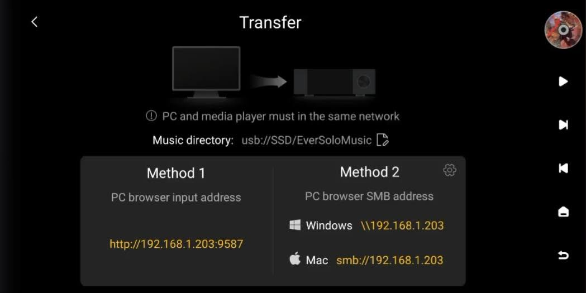

2. **Open that address on your computer.** Type it exactly as shown, including the `:9587` at the end, into the address bar of any browser (Chrome, Safari, Edge) and press Enter. The Eversolo's upload page opens. Click **Upload Apk** at the right.

   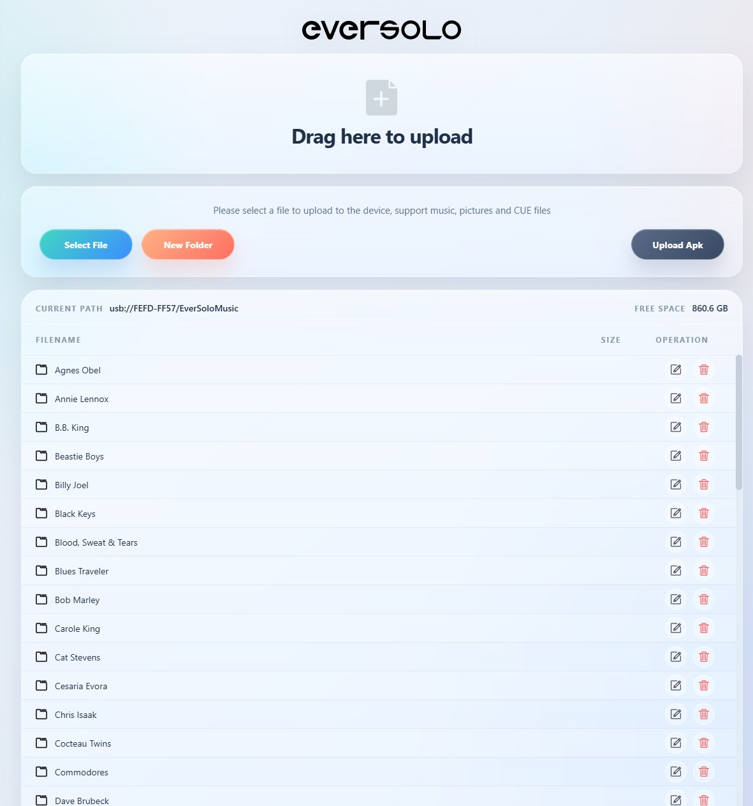

3. **Send the app.** Click **Select APK File**, find the FixMyRips APK where you downloaded it (usually your Downloads folder), and choose it. It uploads and installs on the Eversolo by itself.

   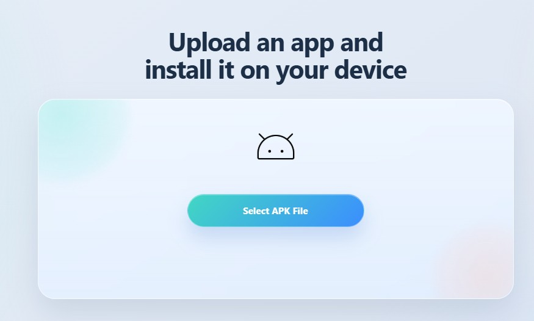

4. **Find it on the Eversolo.** On the home screen, open the **Apps** tab. FixMyRips is listed there.

### Option B: copy it over the network, then tap to install

Use this if the upload page doesn't work for you, or if you already copy music to the Eversolo this way.

1. **Find the network share address.** On the same **Transfer** screen, **Method 2** shows an address for Windows (starts with `\\`) and one for Mac (starts with `smb://`).
2. **Open it on your computer.**
   - **Windows:** open File Explorer, click in the address bar at the top, type the `\\` address and press Enter.
   - **Mac:** in Finder, choose **Go > Connect to Server** (or press Cmd+K), type the `smb://` address and click Connect. If it asks how to connect, choose **Guest**.
3. **Copy the APK** into any folder on the Eversolo, for example the `Download` folder on its SSD. Drag it in like any other file.
4. **Install it from the Eversolo.** On the Eversolo, open the built-in **Files** app, go to the folder you used, tap the FixMyRips APK and tap **Install**. (If you already have an older version, it says it will install an update instead. That's fine: your undo history is kept.)
5. **Tap Open** to start it now, or find it later in the **Apps** tab.

### First launch: give it access to your music

The first time you open it, the app asks for permission to read your music folders and, when you tap Fix, correct their tags. Android asks this in two steps, and both are needed.

1. **Tap Grant access.** The screen explains what the app will and won't do with your files.
2. **Turn on the switch** next to **Allow access to manage all files**. Android's wording sounds alarming because this is a broad permission. FixMyRips uses it only to read your folders, change tags when you tap Fix, and save its list, undo records, reports and updates to Download. Then press the back arrow (top left) to return to the app.
3. **Tap Allow** on the pop-up that follows. The app opens on the list of your drives, ready to pick a music folder.

### Updating later

When a new version is out, tap **Update available** at the bottom left of the folder screen. It downloads the new version to the Eversolo's Download folder. Then open the **Files** app, choose **Storage** on the left (the Eversolo's own storage, not the SSD), open **Download**, tap the new FixMyRips APK and tap **Install**. It installs over the old version; your undo history is kept.

You can also download any version from the [releases page](https://github.com/malbers/fixmyrips/releases) on your computer and use Option A or B.

<!-- TODO before going public: run scripts/new-signing-key.ps1, build the first signed release, then add the
     "Is this file really from me?" section with the SHA-256 certificate fingerprint, as in the AddMyCoverArt README. -->

## Tested on

Eversolo DMP-A6 (Gen 1), Android 11, with CD Ripper FLAC rips. It should work on other Android-based streamers, but that is untested.

## Building from source

Java, plain Android SDK, no third-party libraries in the app code. The phone page decodes barcodes with [@zxing/library](https://github.com/zxing-js/library), bundled unmodified (see [THIRD_PARTY.md](THIRD_PARTY.md)). JDK 17, then:

```
gradlew assembleRelease testDebugUnitTest
```

Release builds are signed with a key kept outside the repo (`scripts/new-signing-key.ps1`); without it they fall back to the debug key.

## Credits

Album, release and barcode data from [MusicBrainz](https://musicbrainz.org), run by the MetaBrainz Foundation. Barcode reading by [ZXing](https://github.com/zxing-js/library).

## Licence

Copyright 2026 Michael Albers ([@malbers](https://www.youtube.com/@malbers)). Licensed under the [Apache License 2.0](LICENSE).

You're welcome to use it, modify it, build on it and send improvements. If you redistribute it or something built from it, keep the [NOTICE](NOTICE) file with it so the credit travels along. The licence doesn't cover the name: please don't publish a modified version as "FixMyRips" or as coming from me.

Contributions are welcome. Anything you submit to this repository is accepted under the same Apache 2.0 licence.

Also from me: [AddMyCoverArt](https://github.com/malbers/addmycoverart) fills in missing album art on the same Eversolo rips.
